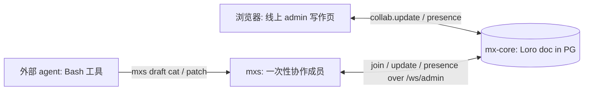
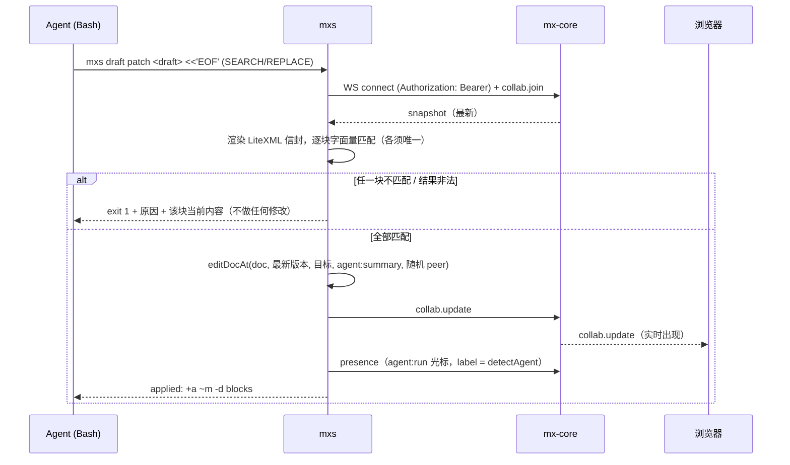

# co-write：接入上游 CRDT 协作 — 设计

> 设计讨论与审批：ryugi artifact `document/co-write-upstream-collab` <https://ryugi.innei.dev/a/_KSi3geC4pSZrOeDy3C->（2026-10-30 批准）。本文件是其定稿副本。两期都在批准当日的会话里实现。

## 意图

`co-write-blog-post` skill 之前靠 `mxs author` 在本地起一个编辑器和一份本地 Loro 协作源：人在本地页面写，agent 改本地 `article.xml`，再三方合并回编辑器，写完才建草稿、传资产。上游 mx-core 现在已有完整的协作栈（PG 里每篇 Lexical 文档一份 Loro doc，`/ws/admin` 上的 `collab.*` 房间，服务端时间线、撤销、恢复），本地那套成了重复建设。

新形态：人直接在线上 admin 写作页里写；agent 用两条 CLI 命令读写同一篇草稿——`mxs draft cat` 读、`mxs draft patch` 写——每次调用临时加入协作房间，修改实时出现在人的编辑器里，带着 agent 名字的光标。草稿的元数据也接进 Loro，和正文一起实时同步。

## 目标

- 人在线上编辑器里写，agent 的修改不刷新就实时出现，光标显示 agent 的名字（如 “Claude Code”），每次修改在时间线里是可撤销的一行。
- agent 只用 `cat` / `patch` 两条命令；人并发打的字永远不会被 agent 的写入静默覆盖。
- 人在浏览器里选中一段，切到终端说“这段”，agent 能拿到那段（失焦后也保留）。
- 元数据（slug、标签、分类、摘要、aiGen、封面、付费墙……）进 Loro：多个标签页和 agent 同时改不同字段互不覆盖。
- 本地 `mxs author` 全套删除，skill 不再有本地目录。

## 非目标

- VFS / just-bash、sh 写入路径、整篇覆盖命令、真实挂载（macFUSE / NFS / FSKit）、MCP（以后可以包一层，语义不变）。
- 常驻进程、本地版本缓存。
- 浏览器侧发起 agent（见“后续脑暴”）。
- Markdown 格式草稿（只支持 Lexical）。
- 给 co-author 的 AI 能力。

## 反目标

- agent 的写入静默吞掉人刚打的字（评测里 sh + sed 出现过一次，这是选 patch 的原因）。
- 人需要离开线上编辑器、刷新页面，或者看本地文件，才能知道 agent 改了什么。

风险评估（你）：基本链路不复杂，主要风险在 agent 修改线上文章的边界情况。测试因此集中在 patch 的匹配与拒绝规则上。

## 总体结构





## 命令契约

```bash
mxs draft cat <draft>                 # 完整信封：<mxpost><meta>…</meta><content>…</content></mxpost>，每块带 id
mxs draft cat <draft> | grep -n 缓存   # 随意接管道
mxs draft cat <draft> --outline       # 标题层级 + 各块 id（长文导航）
mxs draft cat <draft> --selection     # 人当前（或失焦前最后）的选区所在块；没有选区时说明并 exit 0
mxs draft patch <draft> [--message <summary>] <<'EOF'
<<<<<<< SEARCH
<p id="hPzZ7MhV">原文，从 cat 的输出逐字复制</p>
=======
<p id="hPzZ7MhV">替换后的内容</p>
>>>>>>> REPLACE
EOF
```

### `patch` 的规则

1. 输入是一个或多个 SEARCH/REPLACE 块，按顺序作用在**当前最新**渲染结果上，后一块看到前一块的结果。
2. 匹配是字面量：先精确匹配；精确不中时，按行忽略行首缩进再匹配一次。每块必须恰好命中 1 处。
3. 全有或全无：任一块 0 处或多处命中、或替换后的结果解析失败，整个命令不做任何修改，exit 1。错误输出写明第几块、原因（“未找到，可能已被他人修改” / “命中 N 处，请带更多上下文”），SEARCH 里含 `id="…"` 时附上该块的当前内容（块已删除则说明已不存在）。
4. 防静默丢节点：LiteXML 遇到未知标签会静默丢弃。替换后把目标重新渲染，若某个 REPLACE 的内容（去掉 id 与空白差异后）没有出现在结果里，按非法结果拒绝，并指出被丢掉的标签。
5. 正文与标题：`editDocAt(doc, doc.frontiers(), 目标, "agent:" + summary, { peer: 随机 })`，一次调用一个随机 peer；summary 取 `--message`，缺省为 `patch +a ~m -d blocks`。
6. 元数据：`<meta>` 里的改动——一期转成 `PATCH /drafts/:id/fields`（只发变化的键）；二期与正文在同一次 Loro 提交里写入。
7. 服务端拒绝（`DRAFT_CRDT_UPDATE_REJECTED` 等）或网络错误：exit 3，原样报出 code。用法错误 exit 2。无变化 exit 0 并说明 no-op。
8. 没有整篇覆盖：空草稿渲染为一个带 id 的空段落，agent 照样用 SEARCH 命中它。

### presence

- 写入成功后，发一条 `entry: agent:<runId>` 的 presence，`caret = { anchor: null, focus: 最后改动块末尾, label: detectAgent(process.env) ?? "AI" }`，并让光标停留约 3 秒后离开房间；命令本身在 ack 后立即返回，不让 agent 多等（实现方式留给实现者）。
- `--selection`：加入房间后等待浏览器在 `collab.peer.joined` 后重发的 presence（上限约 500 ms），取 owner 浏览器连接里最近一次非空 `caret.selection`，用自己的 doc 补出块文本输出。

## 一期：协作读写

### core（apps/core）

- `/ws/admin` 接受 Bearer session token：`processors/gateway/shared/auth.gateway.ts` 在有 cookie 或 `Authorization` 时都先查 owner session，否则退回 API key。已改好、已有两个 e2e 用例，未提交。
- presence 不改：`caret` 是不透明 JSON（上限 4096 字符），`label` 和 `selection` 原样转发，探针已验证。

### CLI（packages/cli）

- 新增 `mxs draft cat`、`mxs draft patch`（`src/cli/draft/`），注册帮助，并更新 `mxs skill get` 的 draft 章节，写清上面的契约和例子。
- 信封渲染/解析复用现有 LiteXML 信封代码（`mxs draft create --file` 用的那套），正文用 `@mx-space/editor` 的 `serializeMxLexicalToLitexml` / `deserializeMxLitexmlToLexical`，Loro 读写用 `@mx-space/editor/loro` 的 `readDocContent` / `editDocAt`。
- 认证沿用 Profile：device-flow token 走 `Authorization: Bearer`，API key 走 `x-api-key`。WS 地址：admin 用的是独立的 `GATEWAY_URL` + `/ws/admin`，CLI 需要从 profile 推导（实现者先确认线上 `mx.innei.in` 的网关地址）。连上旧服务端认证失败（4401）时提示“服务端版本过旧”。
- 依赖新的 `detect-agent` 包。
- 删除 `mxs author`：`src/cli/author/` 全部、对应测试、帮助注册、`commands-author` skill 章节，以及 admin 里只为它服务的本地 SPA（`apps/admin/src/author/` 及其构建入口、`resolveAuthorSpaDir`）。删除前全局搜索确认没有别的使用方。

### admin（apps/admin）

- 选区协作（`features/write/crdt/crdt-draft-session.ts`、`collab-presence.ts`）：自己的 presence 增加 `caret.selection = { collapsed, blocks: [{ id, startOffset?, endOffset? }] }`，块 id 用 LiteXML 里的同一个 blockId，最多 50 块。失焦（BLUR）时只清掉显示用的 `anchor/focus`，`selection` 保留；`announce()` 重发时带上。
- agent 光标名：收到 `entry` 以 `agent:` 开头的 presence 时，用 `caret.label`（纯文本、截断到 40 字符）替代服务端盖的 `'AI'` 显示在光标标签和头像栈；没有 label 仍是 “AI”。颜色逻辑不变。

### ryugi（另一个仓库）

- 把 `artifacts/src/server/agent.ts` 抽成零依赖包 `packages/detect-agent`（ESM + CJS，导出 `detectAgent`、`AGENT_MARKERS`、`AGENT_DISPLAY_NAMES`，测试随包迁移），npm 包名 `ryugi-detect-agent`（与 `ryugi-artifacts` 同风格）。artifacts 改为依赖它；`hooks/` 里的 CJS 副本改为引用包，或保留并继续由 parity 测试守住。发布走 ryugi 现有发布流程。

### skill（SKILL 仓库 `skills/writing/co-write-blog-post`）

1. [0] 开场两问（人格、语言）照旧；续写时不问，从已有文字判断，判断不了一行问。
2. [1] 新文章：`mxs draft create` 建一个只有工作标题、slug 和一个空段落的 Lexical 草稿；续写：`mxs draft list` 按标题找，多个匹配一行问。给人线上写作页链接，然后停下等人开口。
3. [2] 每个请求：`cat`（指“这段”时用 `--selection`）→ 定位 → 一次 `patch` 只动要求的块 → exit 1 时重新 `cat` 再写一次，仍失败就告诉人 → 一两行回复改了哪里。
4. 资产：图片插入时立即 `mxs file upload`（不加 `--silent`，读 `url:`），宽高与 thumbhash 用 `image-meta.mjs` 从本地文件算；Excalidraw 场景写到临时文件后 `--type file` 上传，正文只放 URL。
5. aiGen：每做出一种新贡献，就在 `<meta>` 里更新 `aiGen`（同一个 `patch`）。
6. [3] 收尾：对 `cat` 的结果跑 no-ai-slop 检查并列出问题（不自动改）→ 确认 aiGen → 用 `patch` 填分类、标签 → 发布必须等人明确同意。付费墙、premium 的规则照旧。
7. 删除：本地 `~/blog-drafts`、`session.json`、`author.log` 等待逻辑、`.selection.json`、“写完才上传”的规则和对应失败条目；README 表格的描述同步更新。

## 二期：元数据进 Loro

- **文档结构**（`@mx-space/editor/loro`）：Loro doc 增加根容器 `fields`（LoroMap），下挂 `meta`、`typeSpecificData` 两个 LoroMap，每个字段一个键；字符串数组（标签等）用 LoroList，其余值按键整体替换（同键并发后写者胜）。`DocContent` 增加 `fields`；`readDocContent` 读出，`editDocAt` 按键差异写入，`createContentDoc` 种入。
- **core**（`modules/draft/draft-crdt.service.ts` 等）：`materialize` 从 doc 的 `fields` 取元数据；`updateFields` / `mergeDocumentFields`（即 `PATCH /drafts/:id/fields`）改为对 Loro 做一次服务端编辑（提交信息 `fields`），经 `onDocumentChanged` 实时转发；restore / undo / legacyWrite 随 doc 自然带上元数据。`content_crdt_docs.fields` 列按 expand–contract 处理：先改为从 doc 派生写入、读取切到 doc，后续版本再删列（遵循 `mx-migration-author` 的滚动发布规则，两副本共存期间旧 pod 的写入不能丢）。
- **迁移**：一个 app-migration（同 `20261026-mint-loro-block-ids` 的写法），把每份已有 doc 的 `fields` 列种进 Loro，提交信息 `migrate-fields`；可重复执行。
- **校验**：`vetUpdate` 增加选项，co-author 的更新只要触及 `fields` 容器就拒绝。co-author 页面不渲染元数据；他们能从完整 doc 里读到元数据，这一点已接受（与已知的 oplog 限制同类）。
- **admin**：写作页的元数据表单直接绑定 Loro 的 `fields`（读实时值、本地改动走 binding 提交），Loro 文档不再走 `diffDraftFields` → PATCH 的路径。
- **CLI**：`patch` 里 `<meta>` 的改动与正文在同一次提交里写进 Loro；`cat` 从 doc 读元数据。命令形状不变。

## 测试与验收

### 一期

- core：网关 e2e（Bearer session 通过；Bearer API key 仍走 API key 路径）——已完成。
- CLI 单测：SEARCH/REPLACE 解析；精确与缩进无关匹配；0 处 / 多处命中；多块全有或全无；带 id 时附当前块内容；未知标签被丢时拒绝；元数据变化转成 PATCH；正文中的 `$ / & . "`、`&amp;`、`&quot;` 字面量往返。
- CLI 集成：两个 socket 的房间测试（参照现有 collab e2e）——人改同一段后 patch 被拒、改别段时 patch 成功且两边收敛。
- admin：失焦后 selection 保留并在 announce 时重发；agent entry 显示 label。
- agent 评测复跑：把 `packages/cli/tmp/agent-eval` 指向真正的 `mxs draft cat/patch`，Claude 与 Codex × 5 个任务全部通过，冲突任务里人的那句保留。
- 端到端（真实浏览器、本地栈）：在 admin 选中一段 → agent `cat --selection` 拿到 → `patch` 改写；人同时在别段打字；浏览器里看到 “Claude Code” 光标和实时改动，时间线一行，撤销后两边恢复。

### 二期

- editor/loro：fields 往返；不同键并发合并；标签列表并发增删合并。
- core：迁移可重复；materialize 读 doc；PATCH 写 Loro 并实时转发；co-author 触及 fields 被拒。
- admin：两个标签页同时改不同元数据字段，互相实时可见、都保留。
- 端到端：人在浏览器改标签的同时 agent 用 `patch` 改摘要，两者都在。

## 发布顺序

1. core 的 WS 认证改动（独立、向后兼容），先发。
2. admin 选区协作 + label（独立）。
3. CLI `cat/patch` + 删除 `author`（依赖 1）；同时发 ryugi 的 `detect-agent`。
4. skill 重写（依赖 3 的 CLI 版本）。
5. 二期按 expand–contract 分两次发布：先双写、迁移、读切到 doc，再清理旧列。

## 验证证据（2026-10-30，本地 core :2399，独立库 mx_collab_probe）

### 探针 1：协作链路

脚本 `packages/cli/tmp/collab-probe.ts`（gitignored）。结论：Bearer session 在 `/ws/admin` 认证通过（依赖本地网关改动）；连接+认证 55 ms，加 join+snapshot 共 134 ms；人与 agent 并发改不同段两边都保留并收敛、实时转发；时间线出现 agent 提交信息；`caret` 里的 `label`/`selection` 原样转发，entry 的 `user.name` 被服务端固定为 `'AI'`；服务端不存 presence，后加入者依赖成员在 `collab.peer.joined` 时重发。

### 探针 2：写入接口评测

原型 `packages/cli/tmp/agent-eval/`（`mxdoc` + 运行器）。Claude Code（sonnet）与 Codex（默认模型）× 5 个任务（改写、插入、删除、全文替换、冲突），每次 agent 首次调用后机器人以人的身份改动；共 45 次。

| 接口 | 通过 | 人的修改丢失 | 失败调用 |
| --- | --- | --- | --- |
| patch（SEARCH/REPLACE） | 15/15 | 0 | 3（全是冲突检测，重读后修好） |
| edit（--old/--new） | 15/15 | 0 | 3（同上；全文替换需 5 次调用） |
| sh（VFS + sed） | 14/15 | 1（静默） | 1 |

决定性的一次：Claude + sh + 冲突，`sed -i "s|<p id=…>.*</p>|…|"` 的 `.*` 吞掉了人刚补的句子，退出码 0。同场景 patch 第一次 SEARCH 不匹配并返回块的当前内容，agent 重读后保留了人的句子。sed 另外两个坑本机复现：不匹配也退出 0；替换里的 `&` 被展开成匹配内容。

## 决策记录

- 去掉本地文件、本地编辑器、本地 CRDT 和 `mxs author`；人在线上编辑器里写。（你）
- 读 `mxs draft cat`、写 `mxs draft patch`（字面量 SEARCH/REPLACE，heredoc，多块原子，不匹配返回当前块）；不做 VFS、sh 写入、整篇覆盖。（你定方向，评测选定 patch）
- 每次调用一次性加入房间、按最新版本应用，无常驻进程、无版本缓存。（你）
- 先做 CLI；以后可包 MCP，语义不变。（你）
- 线上编辑器补选区协作：`caret.selection`，失焦保留，重发时带上。（方向你的，放法我的）
- agent 光标名用 ryugi 的 `detectAgent`，放 `caret.label`，不改 core presence。（来源你的，放法我的）
- `detectAgent` 抽成 ryugi 仓库里的独立零依赖包，包名 `ryugi-detect-agent`。（抽包按推荐；包名我的）
- `/ws/admin` 接受 Bearer session token。（你要求）
- 每次调用一个随机 Loro peer，提交信息 `agent:<summary>`；光标停留约 3 秒，命令不等待。（我的）
- 草稿第一步就建在服务端；资产插入时即上传。（我的，必然结果）
- 全部元数据进 Loro，`PATCH /fields` 改写 Loro；元数据经 `<mxpost><meta>` 信封读写；co-author 写元数据被拒、能读到（已接受）。（你）
- 不为 skill 新增字段：aiGen 用已有 `meta.aiGen`，语言从正文推断，人格不存。（你）
- 命令放在 `mxs draft` 组下。（我的）
- 分两期，都在当前会话做完。（你）
- 风险：主要在 agent 修改线上文章的边界情况。（你）

## 留给实现者

- CLI 的 WebSocket 实现（Node ≥26 内置 WebSocket 能否带请求头，不能就加 `ws`）和网关地址推导。
- `--outline` 的具体格式；presence 停留 3 秒的实现方式（如分离的子进程）。
- 二期 `fields` 容器里非字符串数组值的具体编码，只要满足“不同键并发互不覆盖、标签列表可并发增删”。
- 线上写作页链接的拼法（skill 里给人的 URL）。

## 后续脑暴（不在本次范围）

你的想法：人在浏览器里选中文字 → 点 “call agent” → 写一句评论 → Claude Code 的 Monitor 收到事件，agent 直接开始改，连 `--selection` 这一步都省掉。大概需要一个 `mxs draft watch` 一类的命令把房间里的“召唤”事件逐行输出给 Monitor，以及 admin 里的召唤 UI。以后单独讨论。

## 本次用到的材料

- 设计讨论文档：ryugi artifact `document/co-write-upstream-collab`（mx-core/.ryugi/artifacts），链接 https://ryugi.innei.dev/a/_KSi3geC4pSZrOeDy3C-。
- 探针与评测原型：`mx-core/packages/cli/tmp/collab-probe.ts`、`mx-core/packages/cli/tmp/agent-eval/`（gitignored，结论已写在上文）。
- 相关上游 spec：`docs/superpowers/specs/2026-10-25-collab-realtime-room-design.md`、`2026-10-25-collab-ai-peer-design.md`、`2026-10-25-collab-coauthors-design.md`、`2026-10-25-loro-content-storage-design.md`。
