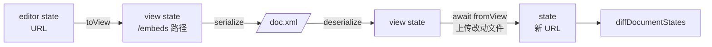

# 嵌入资源进 VFS：设计稿

写作 agent 经 `bash` 虚拟工作区编辑 Excalidraw、Dynamic 组件与图片等本站存储的嵌入资源；三者合为一套基于文件的机制，不设专用工具。经三轮问答与一次建造者审阅定稿，2026-11-08 获批。

讨论原件：ryugi document `document/embed-vfs`（`.ryugi/artifacts/document/embed-vfs/doc.xml`）。其中结论已全数写入本文。

## 1. 缘由

正文中的 `<excalidraw>` 只存一条对象存储 URL。场景 JSON 不在 VFS 里，agent 读不到也写不回：一篇文章要把 6 张图译成英文，agent 只能建议手动导出再上传。

Dynamic 组件走另一套：`read_dynamic_component` 抓源码，`preview_dynamic_component` 交整份源码生成草稿卡片，用户点「上传并插入」才落地。两套规则；excalidraw 无对应工具；图片只能看到 URL，看不到内容。

统一为「嵌入即文件」：agent 用 `cat / sed / heredoc` 改文件，工作区负责上传、换 URL、记版本；改动与正文其余部分一样进入同一套提案审阅。

## 2. 目标与边界

| 类 | 内容 |
| --- | --- |
| 目标 | agent 可读、改、新建、复制 Excalidraw 与 Dynamic；可查看图片内容；生图直接成为 VFS 文件。每次改动成为该嵌入的一个新版本，可在历史中回溯。改动不坏及已发布内容。 |
| 非目标 | 服务端 agent 工具（`ai-agent-server-tools.ts` 的 `read_article`）仍输出原 URL；mxs CLI 不变；dynamic 目录的 `previousUrls` 不迁移；图片内容不可在 VFS 中编辑。 |
| 反目标 | 不改 `rich-litexml` 的语义，不让其知晓 VFS；不覆盖任何已上传文件；不新建表。 |

## 3. 约束

- LiteXML 编解码为多处共用：admin 工作区、mxs CLI、服务端 agent、协作草稿、ryugi 文档。
- 上传永不覆盖：普通上传经 `resolveUniqueObjectKey` 去重，`immutable` 上传落在 `versions/<uuid>`。已发布文章引用旧 URL，直到重新发布。
- 孤立扫描 `findReferencedUrls` 以正则扫各内容表的文本列，读不到 `content_crdt_docs` 的 bytea 快照。CRDT 只在 save / publish / restore / undo / import 时落成 revision。
- 草稿检查点 `appendCheckpoints` 调 `updateReferencesForDocument`，其中 `markDocumentPending` 清空该草稿名下各行的 `ref_id`；发布时 `activateUrl` 改写 `ref_type`。
- 协作者无上传权限（`CoauthorEditor` 的 `refuseSnapshot`）。
- 迁移须 expand-contract（Dokploy 双副本滚动发布），用 `mx-migration-author` skill。
- 前台 Excalidraw 展示用 haklex 自绘的 Scene，读存储的 width/height，不在加载时重算文字尺寸。

## 4. 设计

### 4.1 agent 所见的工作区

```text
/doc.xml                       正文，嵌入以路径引用
/embeds/<blockId>.excalidraw   场景 JSON（补丁后完整场景，格式化），可写
/embeds/<blockId>.js           Dynamic 源码，可写
/embeds/<blockId>.meta.json    Dynamic 的 name / description / propsSchema，可写
/embeds/<blockId>.png|jpg|…    图片、视频、文件：只读，cat 得元数据
/embeds/<blockId>.error        抓取失败原因；对应路径只读
```

```xml
<excalidraw id="xc28xMrt">/embeds/xc28xMrt.excalidraw</excalidraw>
<dynamic id="5rIpK5hR" url="/embeds/5rIpK5hR.js" initial-height="320" />

```

- 路径按 blockId 生成，跨轮稳定。新嵌入由 agent 自取文件名（`/embeds/arch-en.excalidraw`），在 `/doc.xml` 中引用即可；`cp` 后改引用即复制。
- 映射范围：Excalidraw、Dynamic、顶层图片 / 视频 / 文件节点、gallery 内的图。只映射本站存储域名（`collectAllowedImageHosts`）下的 URL；外站链接、map、afilmory 等第三方地址原样保留。
- `<dynamic url>` 仍接受原始 https URL，供插入组件目录中已有组件。
- 二进制文件 `cat` 的输出为元数据：mime、尺寸、字节数、alt。
- delta 快照（baseUrl + 补丁）呈现为补丁后的完整场景，写回时上传完整新文件，弃 delta 形态。inline 快照呈现为文件，写回仍为 inline、不上传。

### 4.2 映射层：中间件

路径与 URL 的互换做在 `SerializedEditorState` 上，夹在 LiteXML 编解码两侧，实现于 `apps/admin/src/vendor/rich-editor/utils/document-bash/`，以选项注入 `createDocumentBashWorkspace`。



```ts
type EmbedMount = {
  prefetch(state: SerializedEditorState): Promise<void>
  seed(fs: IFileSystem): Promise<void>
  toView(state: SerializedEditorState): SerializedEditorState
  fromView(state: SerializedEditorState, fs: IFileSystem): Promise<SerializedEditorState>
}

createDocumentBashWorkspace({ ..., embeds: createEmbedMount({ upload, canUpload, getCurrentUrl }) })
```

- `fromView` 必须在 `diffDocumentStates` 之前完成；否则 base（URL）与解析结果（路径）相比，每个嵌入块都算作改动。
- `/doc.xml`、`/selection.xml`、`/review.xml`、`/.meta/outline` 与 `snapshotFiles` 一律经 `toView`。
- 远端内容按 URL 缓存于工作区实例（URL 不可变，缓存不失效）；每轮首次 bash 调用时并发预取正文中全部嵌入。
- 可选的 LiteXML 小改：excalidraw writer 现仅对 `http / blob / ref:` 开头者写纯文本，路径会被包进 CDATA。放宽为「单行、无空白、非 JSON」即写纯文本，只为可读。

### 4.3 写回流程

每次 bash 调用后，`projectDocument` 在解析 `/doc.xml` 之后、求 diff 之前执行：

1. **核对引用**：`/doc.xml` 引用了不存在的 `/embeds` 路径，则拒绝本次改动并报错。文件存在而无块引用，不上传。
2. **比对内容**：与播种时的内容哈希相同，保留原 URL。同一轮内同一内容只上传一次，按内容哈希复用已得 URL。
3. **Excalidraw 重算文字尺寸**：text 变了的元素，经 `restoreElements(elements, null, { refreshDimensions: true })`（@excalidraw/excalidraw 0.18.1）重算 width/height，懒加载该库与字体。agent 只需改 `text` 与 `originalText`。
4. **核对并发**：上传前比对编辑器中该块当前 URL 与播种时的 URL。不同者，本轮内已有人改过此嵌入：拒绝该块，报「已被他人修改，请重新读取」，不覆盖。
5. **上传**：`immutable` 上传，带 `assetKey` 与 `draftId`（§4.7）。改既有嵌入沿用其 key；新嵌入、`cp` 之副本、生图结果生成新 key。
6. **失败处理**：上传失败，则本次 `/doc.xml` 改动不应用并报错；VFS 中文件保持改后内容，下次调用自动重试。

### 4.4 Dynamic 并入提案审阅

- 删除 `preview_dynamic_component`、`read_dynamic_component`、`DynamicComponentCard`、`publish-dynamic-component.ts`、`liftMisplacedDraftFields` 及相关 i18n。改 `.js` 即上传，成为正文提案，在 diff 中以真 URL 实时渲染，接受 / 拒绝同普通改动。
- 名称、描述、propsSchema 放 `/embeds/<blockId>.meta.json`，工作区校验为 JSON；props 与 initial-height 仍在 `/doc.xml` 的 `<dynamic>` 上。
- **提案中的渲染**：admin 的 `isAllowedDynamicUrl` 另放行本站存储域名下 `versions/` 路径的 `.js`，使未入目录的新版本可在提案中渲染；前台不变。只有 owner 能往此处传 `.js`。
- **只改 `.meta.json`**：节点只存 url、props、initialHeight。只改 meta 时直接写入目录，工具结果注明「已改目录」，不经审阅。不在目录中的组件，`.meta.json` 为空对象；接受其首次提案时新建目录条目。
- **目录登记**：审阅模式于用户接受含该块的提案时登记（挂在 `acceptReviewBatch` 一路）；共享模式写入即登记。修订既有组件沿用 `reviseDynamicComponent`（父 URL、`previousUrls`）。

### 4.5 图片与生图

- **查看**：新增 bash 命令 `view <path>`。工具结果附带图片 URL，不带 base64。
- **传输**：扩展 haklex `rich-agent-core` 的 `AgentToolResult`，加图片附件字段，经 ws 协议传到服务端。服务端调用模型前抓取 URL，缩放至长边约 1568px，编码为 pi-ai 图片块 `{ type: 'image', data: base64, mimeType }`。历史只存 URL，每次请求重新编码。
- **LobeHub 适配器**：`packages/ai/src/runtime/lobehub/lobehub-api.ts` 现把 toolResult 中的图片压成 `[image:mime]` 文字。OpenAI 兼容接口的 tool 消息不能带图，须在 tool 消息之后补一条带图的 user 消息。
- **生图**：`generate_image` 把结果写入 `/embeds/<name>.png` 并返回路径。生图任务已在服务端存下文件，不重复上传：生图请求带 `assetKey` 与 `draftId`，由服务端写入该文件行。

### 4.6 双向同步

| 方向 | 机制 |
| --- | --- |
| VFS → 编辑器 | 不变：每次 bash 调用后投影。审阅模式产提案；共享模式立即应用，未改动块保留原 JSON。新增 §4.3 的上传与并发核对。 |
| 编辑器 → VFS，同一轮内 | 不变：首次 bash 调用时播种，此后冻结。嵌入的并发改动由 §4.3「核对并发」挡下。 |
| 编辑器 → VFS，跨轮 | 快照中嵌入文件的 content 只写版本标识（`asset_key` + URL），不写全文。`reconcileFiles`（`apps/core/src/modules/ai/ai-agent/ai-agent-vfs.ts`）对 `/embeds/` 路径特判：只写一行「此文件已有新版本，需要时请重新 cat」，不生成 diff。 |

### 4.7 版本与清理

- **版本链**：`file_references` 加列 `asset_key text NULL` 并加索引。同一嵌入的各版本共用 key，按 `created_at` 排序即版本链。用 key 不用「上一版本」外键：中间版本被回收后链不断。
- **草稿绑定**：另加列 `draft_id`（可空，上传时写入，此后不改）。不能复用 `ref_type / ref_id`，因检查点与发布会改写它们（§3）。
- **孤立判断的保护条件**：`draft_id` 指向的草稿仍在，且文件上传时间晚于该草稿最新一次 revision，则跳过删除。保存后，revision 中有此 URL 者照常受引用保护，无者（被拒提案的文件）照常回收；草稿删除后全部照常回收。适用 `cleanupOrphanFiles` 与 `batchDeleteOrphans`。亦修复今日编辑器上传的图片在 CRDT 未保存期间被误删之险。
- **不算引用**：`asset_key` 与 `draft_id` 不参与引用判断。
- **上传接口**：`POST /files/upload` 加可选参数 `assetKey`、`draftId`；admin `uploadFile` 同步加参数。编辑器中人手保存 Excalidraw（`saveExcalidrawSnapshot`）也带上 key 与草稿。
- **既有嵌入的 key**：节点不存 key，按 URL 查文件行取得；首次改动时，旧文件行无 key 者补写新 key，使改前版本进入版本链。查无文件行者，新版本另起 key。
- **历史回溯**：文档级沿用 `content_revisions`；单个嵌入按 `asset_key` 查其各版本。
- 两列皆可空，属 expand 型迁移。

### 4.8 权限

无上传权限时（协作者），`/embeds` 只读，写入报错并说明原因。

### 4.9 Prompt 与 skill

- `document-bash/prompt.ts` 加「嵌入文件」一段：路径规则、可写与只读之分、`view` 命令、新建与复制的写法、上传与审阅的含义。
- 新增 bundled skill `excalidraw-editing`（`apps/admin/src/vendor/rich-editor/agent-skills/`）：改字只动 `text` / `originalText`、保留 id、加元素与改色的规则、尺寸由工作区重算。
- 改写 `dynamic-component-design` skill 中的工具用法为 VFS 写法与 meta.json 约定。

## 5. 留给建造者

- `view` 命令在 just-bash 中的实现方式（自定义命令返回附件标记，由工具层收集）。
- 附件字段的确切命名与 ws 帧格式；服务端抓取的超时、大小上限与缓存。
- 二进制元数据的取得方式（节点已有字段优先，缺者 HEAD 请求）。
- 预取的并发数与超时；`.error` 文件的措辞。
- `draft_id` 取 document id 还是 branch id，以能判断「草稿仍在」与「最新 revision 时间」为准。
- 拆分提交与发版顺序（haklex 先发，mx-core 后升级）。

## 6. 涉及模块

| 仓库 | 位置 | 改动 |
| --- | --- | --- |
| haklex | `rich-agent-core` | `AgentToolResult` 加图片附件 |
| haklex（可选） | `rich-litexml` writers/custom.ts | excalidraw 纯文本判断放宽 |
| mx-core admin | `vendor/rich-editor/utils/document-bash/` | EmbedMount、写回流程、`view`、prompt |
| mx-core admin | `utils/dynamic-tools.ts`、`utils/dynamic-catalog.ts`、`features/write/components/agent/` | 删旧工具与卡片；放行 `versions/`；接受时登记目录；生图写入 VFS |
| mx-core admin | `api/files.ts`、`WriteRouteViewsContent.tsx` | 上传参数；人手保存 Excalidraw 带 key |
| mx-core admin | `vendor/rich-editor/agent-skills/` | 新增 excalidraw-editing；改写 dynamic-component-design |
| mx-core core | `modules/file/`、`packages/db-schema`、迁移 | `asset_key`、`draft_id` 两列；上传参数；孤立判断保护条件 |
| mx-core core | `modules/ai/ai-agent/ai-agent-vfs.ts`、`modules/ai/ai-image/` | `/embeds/` 只报版本变化；生图写 key 与草稿 |
| mx-core packages/ai | agent 运行时、`runtime/lobehub/lobehub-api.ts` | 图片附件转 base64 块；LobeHub 补带图 user 消息 |

## 7. 验收

- [ ] 一篇含 6 张中文 Excalidraw 的文章，agent 用 sed 译成英文；提案中 6 张图均为新 URL，文字尺寸已重算；接受后已发布版本不变，重新发布后更新。
- [ ] agent 改 `.js` 与 `.meta.json`，提案中组件实时渲染；接受后目录出现修订，拒绝则目录不变。只改 `.meta.json` 时目录直接更新。
- [ ] 本轮内用户在弹窗中改了同一张图，agent 写回被拒并提示重新读取。
- [ ] 上传失败时正文不变；重试成功后提案出现。
- [ ] `view` 一张图，模型能描述其内容（Anthropic 与 LobeHub 两条路径）。
- [ ] `generate_image` 产出 `/embeds` 文件，引用后成为提案。
- [ ] 同一嵌入的各版本可按 `asset_key` 查出；草稿仍在而 CRDT 未保存时文件不被回收；保存后被拒提案的文件被回收；删草稿后其独占文件被回收。
- [ ] 协作者模式下写 `/embeds` 报只读。
- [ ] 跨轮：用户改了 agent 读过的图，下一轮 system-reminder 只有一行版本提示。

## 8. 决策记录

| 决策 | 出处 |
| --- | --- |
| Excalidraw 与 Dynamic 合一，基于 VFS，不新增专用工具 | 用户 |
| 映射做成中间件，不入 LiteXML 解析器 | 用户认可 |
| Dynamic 并入正文提案审阅，删预览卡片 | 用户 |
| 写入即上传 | 用户 |
| 工作区自动重算文字尺寸 | 用户 |
| agent 编辑原始场景 JSON，配 skill | 用户 |
| 无上传权限时只读 | 用户 |
| 图片等本站 S3 文件入 VFS；多模态查看；生图写入 VFS | 用户 |
| 模型收到的图片为 base64 | 用户 |
| 不建表，复用 `file_references` | 用户 |
| 上传后未保存期间受保护，草稿删除后回收 | 用户 |
| 组件目录于接受时登记（共享模式写入即登记） | 用户 |
| Dynamic 元数据放旁置 meta.json；只改 meta 直接写目录 | 用户 |
| admin 放行本站存储 `versions/` 路径的 `.js` | 用户 |
| 另加 `draft_id` 列；保护条件为「上传后未保存」 | 设计者（建造者审阅后） |
| 已上传文件永不覆盖；delta 写回为完整新文件；inline 写回仍 inline | 设计者 |
| 抓取失败写 `.error`；`<dynamic url>` 接受原始 URL | 设计者 |
| 只映射本站存储域名；gallery 在范围内 | 设计者 |
| 工具结果只带 URL，服务端编码 base64 | 设计者 |
| 跨轮快照只记版本标识 | 设计者 |
| 既有嵌入首次改动时补写旧行 key；生图不重复上传 | 设计者 |
| dynamic 目录 `previousUrls` 暂不迁移 | 设计者 |
