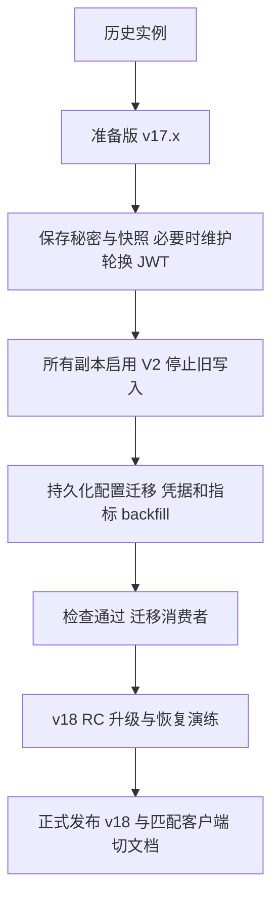

# mx-core v18：兼容性收口与文档迁移

状态：两轮共 13 项范围及完整设计已确认；用户于 2026-11-08 明确要求开始实施。当前开发分支已实施强制加密及配置 DB 迁移与运行时收口，尚未发布；不发布 v18，不操作真实站点数据。

修订（2026-11-08）：用户明确要求本 PR 立即移除非加密运行和旧格式写入，覆盖下文“准备阶段保留逃生口”的安排。显式字段密钥、至少 32 字符 JWT 和固定 V2 写入在本分支立即生效；旧 true 开关仅作为弃用配置接受，false 拒绝启动。历史读取与显式迁移保留。其余 API、SDK 6 和数据库列删除仍按后续阶段执行，当前分支尚未发布。

修订（2026-11-09）：用户明确要求通过 DB 迁移一次性结束旧配置运行时兼容。本 PR 新增必跑的发布前配置数据迁移；先按原路径解密、转换并按新路径加密，删除旧配置行，成功后记录迁移账本。正常 ConfigsService、schema 和 PATCH 只接受规范结构；旧字段按 schema 严格拒绝。历史转换器只供发布迁移、只读检查与历史导入恢复使用。此配置契约切换需要先停止旧副本及后台写入者，不能把此 contract 当作任意 v17 副本仍在写时的滚动迁移；不涉及删除数据库物理列或其他 API 变更。

升级入口收口（2026-11-09）：按用户要求删除独立 prepare、dry-run 和准备标记。配置、凭据及 AI 指标统一由正式 `migrate` 完成；新增必跑 `20261109-required-secret-storage`，复用历史凭据转换行为，并以新迁移 ID 保证旧 opt-in 账本不会跳过本次回填。删除凭据迁移开关及专用脚本。独立 CLI 仅保留只读 check 和需要旧、新秘密文件的 JWT 维护轮换。

基线：Core `v17.0.4`（`c6551f15a`）；SDK `5.13.1`；官方文档仓库 `mx-space/docs` 的 `main`（`cc0f960`，Astro + Fumadocs）。版本号仅是核对基线，准备版和消费者的最低发布 tag 要以实际验证结果确定。

## 意图

让凭据存储、读取与生成、配置写入和已废弃接口形成明确契约。现有实例先在可以继续服务的准备版中发现和处理升级问题，再切换到 v18。不能在滚动切换时删除旧副本仍使用的列，也不能用新密钥代替丢失的原秘密。

## 已确认范围

| 项目        | 决定                                                                                        |
| ----------- | ------------------------------------------------------------------------------------------- |
| 加密必填    | v18 要求显式 64 位十六进制字段密钥，结束关闭加密与机器标识回退                              |
| V2 写入     | v18 统一配置/Snippet 的 GCM、Webhook 加密、API Key 哈希与 OAuth 加密，退役旧格式写入开关    |
| 历史读取    | 保留历史明文/ECB 的读取和迁移、旧 ZIP/v1 加密备份恢复、旧密码登录后升级                     |
| 升级基线    | 只有完成准备的 v17.x 可直接升 v18；更老版本先完成历史迁移                                   |
| 已废弃入口  | 移除评论列表的 `state` 查询别名和速记表态 GET；先迁 SDK、CLI、官方主题                      |
| 旧配置      | AI、第三方服务、会员配置先持久化迁移，再移除运行时读取兼容；清理无效参数和 MongoDB 日志残留 |
| 文档节奏    | 先纠正 v17 和补 v15–v17 指南；v18 发布时切默认示例，并保留 v17 关键入口                     |
| AI 普通读取 | v18 摘要/精读 GET 只读；缺结果返回 `{ data: null }`，生成显式触发                           |
| 执行类 GET  | 非流式备份/清缓存/测试邮件等改 POST，保留现有 GET SSE 和帧协议                              |
| 配置验证    | v18 拒绝未知配置字段，保留大小写归一化、部分更新和自由 JSON                                 |
| AI 指标     | 先补齐 generationMetrics 并停止旧列引用，v18 再删除旧字段和物理列                           |
| 排序        | 服务端统一 `asc`/`desc`；兼容 SDK 先转换 `1`/`-1` 的调用                                    |
| SDK 与别名  | 协调 SDK 6.x 清理确认废弃项；保留 SDK legacy、CLI V2 适配和其他有效路由别名、长期 URL       |

## 不纳入

API v4、wire 大小写/envelope 重做、SSE 帧协议重做、强制加密全部备份、密码重置、历史 SQL 迁移删除、长期 `/objects` 和 `/fn` URL 改名。内部重构不自动成为用户可见的 Breaking Changes。

## 当前准备阶段的交付

1. 增加后续需要的 POST 入口，并迁移 Admin 和兼容 SDK；保留旧 GET。
2. 将旧配置转换抽为可复用模块，支持持久化准备与旧接口写入转换，保持 v17 的已承诺形状。
3. 补齐 AI 指标；让服务端运行时不再读写旧元数据列，旧 v17 响应从新指标派生，暂不删除物理列。
4. 提供只读 `upgrade:check` 和安全的 JWT 轮换工具；所有数据转换统一使用正式 `migrate`。命令支持构建后的交付与本地源码执行。
5. 完成 v17 事实文档纠错、v15–v17 迁移入口及 v18 预告，提供可执行准备说明。
6. 行为测试、真实临时 PostgreSQL 升级演练、构建和独立整体验证；保留原有工作。

准备阶段不切换普通 AI GET 的既有默认行为，配置 PATCH 已严格拒绝旧/未知字段，其他既有参数暂保持，不删除 SDK 5.x 的公开签名，不删除数据库列，不修改线上环境或发布标签。

## 安全配置与迁移契约

### 当前分支已生效的启动条件

- 显式 `ENCRYPT_KEY`/`MX_ENCRYPT_KEY` 为 64 位十六进制；`JWT_SECRET` 至少 32 字符。保留既有别名优先级。
- 新装生成每实例随机密钥并持久保存；现有密钥原样保留。生产模板不能内置公共有效密钥。
- 工程选择：旧 `ENCRYPT_ENABLE=true`、`MX_SECRET_STORAGE_V2=true` 暂接受并提示可删除；显式 false 拒绝启动。新写入固定 V2，`ENCRYPT_ALGORITHM` 只服务历史读取。
- 新装空库由发布前迁移初始化当前状态，不要求 v17 历史；既有实例需要准备完成。
- 普通生产启动检查配置和 schema，不做业务数据迁移；部署前统一运行正式迁移。

### 检查与正式迁移

`upgrade:check` 不启动 HTTP/业务模块，不因普通配置初始化提前退出而丢失诊断。输出人可读摘要或 JSON：新装识别、配置缺失、密文类型计数、旧配置计数、指标覆盖和正式迁移状态。退出状态区分 ready、needs-action 和检查失败；不得输出秘密值。

停掉全部旧副本和后台写入者后，运行 `node migrate.mjs`（源码为 `pnpm -C apps/core migrate`）。迁移使用 slim runner、数据库 advisory lock 和每项独立账本，支持失败阻断与幂等重试。没有独立准备标记或凭据迁移开关；旧凭据迁移账本不能跳过新的 v18 凭据迁移。失败批次回滚，先前完成的迁移保留账本。

顺序：迁移 schema → 回填 AI 指标 → 按原路径解密并转换旧配置、按新路径加密 → 转换 Snippet/Webhook/API Key/OAuth → 运行只读检查 → 启动新业务。API Key 原始字符串仍可用，不重复哈希，不把哈希当作客户端凭据。

已按 2026-11-09 修订结束运行时旧结构兼容：发布前必跑配置数据迁移，普通读取与 PATCH 仅处理规范结构。转换器仅在发布迁移与离线工具中复用；迁移和正常配置写入使用同一个数据库锁。

坏密钥、坏密文或未知格式必须失败，不回落为明文成功。报告只带字段路径/记录 ID/计数，不带值。原实例若曾用 machine-id 加密，准备期先取得等效密钥并显式保存；不能生成新随机密钥替代。

### 短 JWT 的维护窗口处理

工程选择：不自动补齐/截断/覆盖 JWT；暂停全部业务副本和后台写入，以只读秘密文件向独立进程提供旧、新 JWT。事务内验证并用旧 JWT 解封装 OAuth，再用新 JWT 重封装；旧明文按已知格式转换。命令行只出现文件路径，日志不含秘密。

成功后由操作者将全部副本配置为同一新 JWT，再启动。明确要求重新登录；保留 provider token，不主动联系服务商，不改变原字段密钥和 API Key 字符串。错误旧 JWT 整批回滚，不清空 token。缺少原 JWT 且存在密文时阻塞并报告记录，由操作者恢复原秘密或完成账户重新授权。没有现有密文时也要说明轮换与会话影响。

## AI 指标的 expand-contract

旧列：`ai_translations.ai_model`、`ai_translations.ai_provider`、`ai_insights.model_info`。

准备版先补齐新指标，并停止运行时 SELECT/INSERT/UPDATE/RETURNING 对旧列的引用，包括隐式全列展开。旧 v17 API 的 `aiModel`/`aiProvider`/`modelInfo` 从新指标派生，物理列保留。

所有副本运行准备版且覆盖验证通过后，v18 发布前迁移才删旧列；v18 views、Admin 和 SDK 6.x 同步去除旧字段/fallback。相关响应缓存版本化或定向失效，不清空所有 Redis 状态。验收须将准备版代码运行在已删旧列的临时 schema 上。

## API 与消费者

| 入口                                                 | v18 契约                                                     | 准备版工作                                                  |
| ---------------------------------------------------- | ------------------------------------------------------------ | ----------------------------------------------------------- |
| 摘要/精读 GET `/article/:id`                         | 只读，缺结果 `data: null`；资源存在性、隐藏/会员等权限不放宽 | 保持 v17 默认；SDK 6.x 读取准备版时显式 `onlyDb=true`       |
| 显式 AI 生成                                         | 保留既有任务或生成入口；GET SSE 与 token/done/error 帧保留   | 不改公共 SSE 字节协议                                       |
| `/comments?state=`                                   | 明确错误并引导 `tab`，不静默忽略；更新 body 的 state 仍有效  | 消费者用 tab，旧书签可在客户端转换                          |
| `/recently/attitude/:id`                             | POST，保留 attitude 查询参数与业务结果                       | SDK 提前用已有 POST                                         |
| `/backups/new`                                       | POST，保持二进制、文件名、权限与内容类型                     | 新增 POST，同时保留 GET；不能占用上传恢复的 POST `/backups` |
| `/clean_catch`、`/clean_redis`、`/health/email/test` | 原路径改 POST，保持响应/权限；GET 不再执行                   | 增加 POST，迁 Admin/脚本，旧 GET 留到 v18                   |
| sortOrder / sort_order                               | 仅 asc/desc，数字及数字字符串明确验证错误                    | SDK 输出规范化，CLI/主题迁字符串                            |

业务 JSON/envelope、wire snake_case、请求大小写归一化保持。v18 移除的执行 GET 返回无副作用 404/405，不用会执行旧动作的重定向。生成缺结果的主题显示“尚未生成”，不自动换一种请求继续隐式生成。测试邮件只用替身验收，不发送真实邮件。

严格配置仅作用于配置 PATCH/初始化配置写入。在归一化后，未知的声明字段路径返回 HTTP 400 `CONFIG_VALIDATION_FAILED`，列出路径而不含值；嵌套声明对象也校验，record/freeform/meta/Snippet JSON 动态键保持。部分更新、空秘密保留旧值保持，Admin/CLI 用实际 PATCH 验证而非静态表测试。

## SDK 与版本矩阵

- 先发 SDK 5.x 兼容版：速记 POST、排序输出规范化、新执行入口、必要认证修正。保留已承诺签名，不在 patch 删除方法。
- 协调 SDK 6.x：删除确认失效的 `getDeepReading`、`getMasterInfo` 别名、误导 query token 参数、通用 `ResponseMeta` 等；仍应工作的认证能力有替代调用，不能只是删除。
- SDK 6.x 的普通 AI 读取在准备版和 v18 上都只读，类型可空，元数据使用 generationMetrics。
- 保留 `api-client/legacy` 与 CLI V2 响应适配。CLI 访问 Core v18 使用 API v3 profile，不把产品版本当 API 版本。
- 保留其他有效路由别名和长期 `/objects`、`/fn` URL，文档只标规范入口。

准备版 Core 必须兼容原客户端、SDK 5.x 兼容版和新 SDK 6.x；v18 正式支持匹配的内置 Admin、SDK 6.x 及实测 CLI/主题版本，不宣称未适配客户端兼容。准确最低版本在发布验证后写入矩阵。

## 文档修改地图

正式文档仓库是 `mx-space/docs`，内容目录保持 `content/docs`，使用已有 Astro/Fumadocs 组件。内部设计不能直接充当用户操作指南。

第一批按当前 v17 修正事实：

- `configure/encryption.mdx`：显式 hex 校验、逃生口边界、已有密钥保留，删除错误的 machine-id/短密钥建议；区别字段密钥、JWT 与恢复私钥。
- `configure/environment.mdx`：V2/backfill 前置条件，Redis 真实优先级（CONNECTION_STRING → CONNECTION → URL），版本化必填要求。
- `deploy/docker.mdx` 和 `src/components/env-variable-config.tsx`：生成 YAML 映射而非 `- KEY=value` 列表，字符串正确引用；app/migrate 共用配置；新装密钥持久保存。
- `deploy/source.mdx`：Node 26 已是 v15 要求，补发布前迁移步骤，避免重复等价构建。
- `use/backup-restore.mdx`：补 `.mxbackup`、公私钥分工、旧备份读取、原凭据密钥仍需保留；字段必填不代表备份加密必填。
- 补 `migrate/v14-to-v15.mdx`、`v15-to-v16.mdx`、`v16-to-v17.mdx` 与导航：Node 26、BCP 47、Agent 协议和历史对话清空是历史变更，不算 v18 新破坏。
- 增加明确标“计划/准备中”的 v18 预告与准备说明，不能提前把默认文档写成 v18 已上线。

第二批随 v18 正式发布：

- 新增 `migrate/v17-to-v18.mdx`；接入 `migrate/index.mdx`、`meta.json`、`use/update.mdx`。
- 快速体验、Docker/源码示例切换必填配置，持久保存随机实例密钥，不维持公共密钥的“零配置”。
- AI、评论、账号安全页面按真实 UI 与语言代码核对；补方法/路径、排序、未知字段、元数据对照表。
- 保留固定到 v17 的关键部署/加密说明入口，旧链接明确版本与升级方向。
- 同步 Agent 模板和静态 skills；验证生成的 llms.txt/llms-full.txt，不手工维护另一套副本。

每项 Breaking Changes 说明受影响对象、旧新行为、迁移步骤、验证和回退边界。部署说明固定已发布镜像/编排版本，不仅让用户 pull latest。

## 发布与恢复顺序

回退最低版本是实测准备版（能读 V2/新配置且不再引用旧列），不是任意 v17。回退代码不回退 schema；更老版本需要完整旧快照与当时的秘密。区分代码回退、数据库恢复、文件恢复。

历史备份恢复先验证归档与当时的字段密钥/JWT/恢复私钥，隔离验证转换后再服务。环境不能自动隔离预检时提供离线“隔离恢复 → migrate → check → v18”路径，不能报告成功后把未迁移数据交给业务。保留恢复前快照；不得持久保存新的公开秘密副本。

## 验收

- 新装、历史明文、ECB、V2；缺密钥/坏密钥/短 JWT/显式禁用的独立诊断。
- 错误原密钥/JWT、损坏密文、未知形状失败不写对应迁移完成记录；失败批次回滚，重跑不重复哈希或重置 Token。
- AI 普通 GET 缺结果不调用模型/任务/写仓库；权限、SSE 字节和显式生成保持。
- 新 POST 与旧 GET 在准备版并存；鉴权、下载、Admin 操作、SDK 调用真实通过。
- 严格配置与规范排序在 v18 生效；准备版保证旧契约，SDK 转换后的实际排序正确。
- 删除旧列的临时 schema 上运行准备版仓库/服务，不再引用旧列；旧字段从指标派生且数据覆盖完整。
- 历史归档恢复和原秘密要求有演练；失败不报告成功，不暴露未准备数据。
- docs：build、Astro check、产物死链、pangu、lint、真实预览并解析复制的 YAML，核对 llms 与版本入口。

既有基线问题：Core 全量测试的 `admin-agent.e2e-spec.ts` 缺 `AiAgentConversationRepository`，初始化和清理失败。验证时明确报告，不伪称全绿，也不把无关修理混入本次范围。

## 实现者裁量与记录

可自行决定内部模块、命令参数布局、事务批次和测试 fixture，但不得改变行为和失败边界。准备版最低版本、迁移 id、消费者最低 tag 以实施后的证据固定。测试验证行为，不对静态常量、源码行或内部对象做快照。

讨论文档：`document/mx-core-v18-compatibility`，路径 `.ryugi/artifacts/document/mx-core-v18-compatibility/doc.xml`，链接 https://ryugi.innei.dev/a/ZTsqm6DOJbAGibGoCjgD1。两轮 13 项选择及处理说明已归档，独立设计审阅结论为 “nothing important left”；用户随后明确同意开始准备版。未制作 UI mockup，保持现有视觉风格。

## 准备阶段验证记录（2026-11-08）

- 准备功能代码提交至 `c62cf18e8`；Core 保留 v17 行为，未发版、未推送、未执行生产迁移。最低公开准备版 tag 与 SDK/CLI/主题版本矩阵仍待发布验证。
- Core 全量回归显式排除原有 `admin-agent.e2e-spec.ts` 的缺失 DI 夹具后，430 个文件、3569 项测试通过，11 项跳过。该夹具仍未修复，不能声称包含它的原始全量测试通过。
- SDK 207 项测试、Admin 8 项请求行为测试及各包类型检查通过；Core/Admin 生产构建、API envelope/验证配对检查及 50 个迁移文件的 lint 通过。
- 真实临时 PostgreSQL 验证了旧列删除后的仓库读写/返回值、原路径解密和新路径重加密、dry-run、幂等、错误密钥、损坏 OAuth、冲突凭据、事务提交失败与并发缓存发布顺序。历史 ZIP/v1 归档经真实 pg_restore 后，由构建产物完成 dry-run、prepare、check 并保留原凭据。全部使用隔离测试数据库。
- 独立整体验证发现的 2 项 Critical、2 项 Important 已通过先失败后通过的行为测试修复；未再次分派审阅。另补「仅有分类等业务数据时不得判为空库」回归。缓存加密验证比较解密后的原值，不把随机 GCM 密文字节相同当作契约。
- 官方文档工作区 `/Users/innei/git/innei-repo/mx-docs` 的 `545e5c8`、`0719e79` 已本地提交，build/check/links/pangu/lint 与 3 项配置生成测试通过。保留原有 1 条 Astro hint、1 条既有死链；真实预览浏览器和临时 Compose 容器验证了复制映射、字符串类型与美元符号保留，生成的 llms 内容已核对。

裁量保持：先抽纯加密/字段路径模块以支持独立诊断，仅改变实现顺序；启动强制、配置 DB 迁移和严格配置已按用户修订在本分支实施；只读 AI 默认行为、SDK 6 清理和物理列删除仍属后续阶段。当前没有自动隔离恢复入口，继续使用离线恢复到准备版再准备的路径；回退最低公开版本与消费者矩阵仍须发布后实测确定。原有 Agent 测试夹具另行处理。

## 强制加密修订验证（2026-11-08）

用户明确要求本 PR 删除非加密运行，已移除 enable/V2 模式分支、明文/ECB 写入、机器 ID 与短密钥派生；配置、Snippet、Webhook 固定 GCM，API Key 固定哈希，OAuth 不再在数据库 hook 中解密后写入。旧数据读取、离线检查和维护迁移保留。旧 true 标记仅提示弃用，显式 false/无效标记拒绝启动；字段密钥和 JWT 同时必填。

- 定向 49 项测试通过，包括独立进程配置拒绝、无开关启动、历史 ECB、事务迁移与构建后 CLI 恢复演练。旧实现下新增启动测试有 6 项失败，固定 V2 写入测试亦先失败。
- 完整 Core 回归：431 个文件、3576 项通过，11 项跳过；仍显式排除原有 Agent DI 夹具。JWT helper 另 4 项通过。
- Core 生产构建、Core/E2E 类型检查、API envelope/验证配对检查、50 个迁移 lint、冻结 lockfile 校验通过；构建产物已不含关闭加密报错或 machine-id 回退。
- 两份 Compose 均验证缺秘密拒绝、别名和主键优先级、app/migrate 同值；示例不再带关闭开关或公共生产秘密。PM2 与 CI/release 测试环境已同步。
- mx-docs 的 3 项测试、build/check/links/pangu/lint 通过，生成 llms 内容包含新要求；v17.0.4 页面明确固定历史行为，当前开发分支说明明确强制加密已实现。保留既有 hint 和死链。

最终独立审阅：无 Critical、1 项 Important、无 Minor。保留的旧凭据迁移会将历史 Better Auth hex 密文当作明文二次加密；已复用严格解封装逻辑，新增历史 token 保留/幂等、错误原 JWT、截断密文整批回滚 3 项行为回归，均先失败后通过。修复后完整回归为 431 个文件、3576 项通过、11 项跳过，排除项不变；重新构建和类型检查通过。未再次派发审阅，未操作生产。

## 配置 DB 迁移与运行时收口验证（2026-11-09）

新增必跑发布前数据迁移 `20261109-canonical-config`，以数据库事务及配置锁完成旧 GitHub、会员、图片/TTS 和嵌套 SMTP 配置转换，按原路径解密并按新路径加密，删除旧媒体配置行。旧转换器已从 `modules/configs/legacy-config.util.ts` 移到 `database/app-migrations/helpers/legacy-config.ts`，仅由发布迁移及离线工具调用；运行时服务、schema、defaults 不再转换或派生旧结构。启动检查配置迁移账本，旧分区读写明确失败，声明字段严格校验，自由 record、大小写归一化、部分更新和空秘密保留仍有效。SDK 配置类型已同步，大版本配套发布时使用，不以 5.x patch 发布。

- 新增真实 PostgreSQL 发布 runner 自动迁移、凭据保留/AAD、重复执行、冲突/坏密文/坏数据形状回滚、缺账本启动拦截，以及新配置服务拒绝旧字段/分区和自由 OAuth JSON 的行为回归，均已验证先失败后通过。原有旧接口接受测试已改为迁移或拒绝契约测试。
- 完整 Core 回归使用 CI 的 UTC 时区与 3 workers：433 个文件、3574 项通过，11 项跳过；继续显式排除原有 Agent 缺 DI 夹具。4 workers 的两次尝试遇到既有 Redis 端口分配冲突，相关文件独立重跑通过；本地零点日期用例在 UTC 通过，未修改这些无关用例。
- SDK 207 项通过；Core/Admin 生产构建、Core/Admin/SDK/E2E 类型检查、API envelope/验证配对检查、50 个 SQL 迁移 lint 通过。E2E 后端准备在 app.init 前运行真实 app-data runner。
- mx-docs build/check/links/pangu/lint 与 3 项配置生成测试通过，llms 产物包含维护切换与新配置契约；既有 1 hint、1 死链保持。
- 维护窗口是此次配置 contract 的部署条件：先停全部旧副本及后台写入者，再运行 migrate，完成准备后启动新服务。未执行线上迁移、未发布版本、未删除物理数据库列。

最终配置审阅：无 Critical、2 项 Important、无 Minor。已修复「未覆盖的原始分区坏形状被默认值覆盖」和「缺少可选 GitHub 时其他第三方凭据被重置」两处数据保留问题，新增 5 项真实数据库回归并验证先失败后通过；修复后的配置/升级定向回归 67 项通过，构建、类型检查通过。未再次派发审阅。

修复后完整 UTC/3 workers 回归实际结果：3576 项通过，11 项既定跳过，另 1 个未触及的 Push Relay SQL 迁移测试文件因 Redis 端口竞争在 setup 阶段失败、3 项未执行；该文件独立重跑 3 项全部通过。合计 3579 项行为已验证，所有代码断言通过；原完整命令因基础设施错误退出非零，不能称该次单命令全绿。Agent 排除项不变。67 项配置/升级定向回归及重新构建、类型检查通过；无未修复 Critical/Important 或延后 Minor，未再次派发审阅。

共享模块归位（2026-11-09）：配置迁移、历史配置转换和 OAuth 解封装已统一归入 `database/app-migrations/helpers`。正式 app-data migrations 只依赖该目录；`src/upgrade` 在后续入口收口后仅保留只读检查和 JWT 轮换，不再被正式迁移反向引用。

模块归位验证：现有历史转换行为测试先改用新模块路径，验证迁移前因模块未就位而失败；移动后 11 个文件、71 项定向测试通过，包含真实发布迁移、凭据保留、JWT 轮换和构建后 CLI 恢复演练。Core 构建、Core/E2E 类型检查、响应/验证检查、50 个迁移 lint 通过；正式迁移不再引用 `src/upgrade`。本次没有更改数据转换算法或迁移 ID。

## 删除独立 prepare 的验证（2026-11-09）

- 删除命令、实现、dry-run/副本参数、准备标记和 opt-in 凭据迁移入口。正式发布链必跑 `20261109-required-secret-storage`，配置转换和指标回填继续由各自正式迁移完成。
- 5 项新增行为回归先失败，再通过：没有开关也回填凭据、历史凭据迁移记录不会跳过本次回填、损坏 OAuth 阻断发布并回滚凭据批次、已删除命令不写库、检查不再要求准备标记。34 项定向测试通过。
- 历史 ZIP/v1 归档恢复到隔离 PostgreSQL 后，经构建产物 `migrate.mjs` 和只读 check 验证原凭据保留。演练 fixture 同步覆盖两个 PG 连接别名，避免继承测试环境连接到其他库。
- 原始全量命令确认既有 `admin-agent.e2e-spec.ts` 缺 `AiAgentConversationRepository`，初始化及清理失败；初次归档演练的连接别名问题修正后单独通过。最终明确排除该既有 Agent 夹具重跑：433 个文件通过、3 个文件跳过，3576 项通过、11 项跳过，退出 0。没有声称未排除夹具的原始命令全绿。
- Core 构建、Core/E2E 类型检查、API envelope/验证检查、50 个迁移 lint、定向 ESLint/Prettier 和 diff 检查通过。官方文档 build/check/links/pangu/lint 与 3 项测试通过，生成 llms 已同步；保留既有 1 条 hint 与 1 条死链。

## Admin 设置迁移验收（2026-11-09）

- 通过当前分支启动隔离 PostgreSQL、Redis、Core 和 Admin，先写入旧 GitHub、会员、嵌套 SMTP、图片/TTS 配置，再执行正式迁移并以真实 owner 登录。
- 18 个设置分区使用真实 Admin API 客户端读回保存，发现评论上传的 `singleFileSizeMB` / `readerTotalActiveBytesMB` 经 wire camelization 变成 `Mb`，导致输入为空且严格 PATCH 返回 422。新增 3 项回归先失败，再修复：后端按声明 schema 恢复字段大小写，Admin 按已有表单 schema 恢复值的键名，不增加请求或改变 wire/DB 名称；未知、退役字段仍拒绝。
- 修复后 18 个分区全部通过；实测 GitHub、会员、SMTP 与 AI 编辑器编辑、保存、刷新回显，5 个凭据原值保留且仍以 V2 认证加密。评论上传值改为 7 / 70 后刷新和数据库均一致。
- Admin 73 项定向测试、Core 40 项定向测试通过；最终 Core 回归 3578 项通过、11 项跳过，明确排除既有 Agent 缺 DI 夹具。Core/Admin 构建及类型检查、API guards、定向 lint/format 与 diff 检查通过。
- 实际截图和录像：[Admin 设置验收页](https://ryugi.innei.dev/a/48IrQ95Vj1VecQTZtWKtf)。文件与布局检查干净；用户已在验收页及对话中确认通过。验收覆盖设置的显示、提交和持久化，使用虚构凭据，不代表真实邮件、支付或模型服务商连通性验证。
